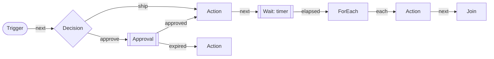

A workflow is a business process that is defined as data and runs as a durable process: when an order is placed,
wait for an approval, call a capability, wait a day, fan out over its lines and join the results. The engine in
`Cratis.Orleans` runs it on grains, so a run survives a silo restart, a deactivation and a move between silos in the
same way the [state machines](state-machines.md) do, and node work runs as [jobs](jobs.md), so it is retried,
stoppable and recoverable like any other job.



## The model

A workflow is a `WorkflowGraph` of nodes and edges.

| Node | What it does |
| --- | --- |
| `Trigger` | The entry point. A run starts here and leaves through `next` |
| `Action` | Performs a capability - typically sends a command - through an `IWorkflowNodePerformer` |
| `Decision` | A capability that chooses one of the node's named outlets |
| `Wait` | Waits for a signal, or for time to pass (`elapsed`), and can expire (`expired`) |
| `Approval` | Waits for a person to decide (`approved` or `rejected`), and can expire |
| `ForEach` | Fans out over items with bounded parallelism, one branch per item, leaving through `each` |
| `Join` | Gathers the branches of a `ForEach`: `All`, `Any` or `AtLeast(n)`, leaving through `completed` or `partial` |

A node has named **outlets** and an **edge** connects one node's outlet to another node. The well-known outlets are
`next`, `failed`, `fallback`, `each`, `completed`, `partial`, `resumed`, `elapsed`, `expired`, `approved`,
`rejected` and `cancelled` (`WellKnownOutlets`); a decision names its own. Each node also carries a
`WorkflowNodePolicy`: the maximum number of attempts, the timeout of an attempt, the delay between attempts and the
maximum number of visits to the node, which is what lets a graph loop and still terminate. A failure that has no
connected `failed` outlet fails the run, and a node that no path reaches is recorded as unreachable.

A **definition** is a versioned `WorkflowDefinitionSnapshot`: the graph, the owner key (`Area`), the subject kind
the workflow is about, and the capability versions it is pinned to. A run pins the snapshot it was admitted
against, so changing a definition never changes a run in flight. Checking the graph's structure is part of admission
(`StructuralAdmissionPolicy`); add your own checks by implementing `IWorkflowAdmissionPolicy`.

## What you provide

### Capabilities

Node work is done by an `IWorkflowNodePerformer`, found by the capability a node references:

```csharp
public class ReserveStockPerformer(ICommandPipeline commands) : IWorkflowNodePerformer
{
    public CapabilityReference Capability => new("orders.reserve-stock", 1);

    public async Task<WorkflowNodeOutcome> Perform(WorkflowNodeInvocation invocation, CancellationToken cancellationToken)
    {
        // invocation.IdempotencyKey is the same for every attempt of this node execution:
        // use it to deduplicate the external effect.
        var reserved = await Reserve(invocation.Input, invocation.IdempotencyKey, cancellationToken);
        return reserved
            ? WorkflowNodeOutcome.Succeeded("next", output: "{\"reserved\":true}")
            : WorkflowNodeOutcome.Failed("no stock");
    }
}
```

An outcome is `Succeeded` through an outlet, `Failed`, `Skipped` or `Ambiguous` - the external effect may or may not have
happened, which stops the run for reconciliation rather than repeating it. A performer that has to do several
things in order, each recorded before the next starts, implements `IStagedWorkflowNodePerformer` and names its
operations. Register performers as services, or let the engine find them: an implementation that is not registered is
created with the container supplying its dependencies.

### Definitions

Definitions come from an `IWorkflowDefinitions` source that says which workflows it owns and returns the active
snapshot; the sources are combined, and a workflow owned by two of them is refused.

```csharp
public class OrderWorkflows : IWorkflowDefinitions
{
    public bool Owns(WorkflowKey workflow) => workflow.Workflow.Value.StartsWith("orders.", StringComparison.Ordinal);

    public Task<WorkflowDefinitionSnapshot?> GetActive(WorkflowKey workflow) => /* load it */;
}
```

## Runtime

Two grains run the engine.

- **`IWorkflow`** - one per workflow, keyed by scope and workflow id - resolves the active definition, applies the
  admission policies and admits the run.
- **`IWorkflowRun`** - one per run, keyed by scope and run id - is the durable process.

A run is derived from the workflow and the trigger's deduplication key, so a trigger delivered twice finds the run the
first delivery started.

### The run's state is its journal

A run grain keeps no state of its own. Everything that happened to it is a fact - `WorkflowRunAdmitted`,
`WorkflowNodeScheduled`, `WorkflowNodeSucceeded`, `WorkflowNodeAttemptFailed`, `WorkflowWaitOpened`,
`WorkflowWaitResolved`, `WorkflowBranchesFannedOut`, `WorkflowBranchesJoined`, `WorkflowRunSucceeded`,
`WorkflowRunFailed`, `WorkflowRunCancelled` and the rest of `WorkflowRunFacts.Types` - recorded in an
`IWorkflowRunJournal`. Every time the grain activates it loads its facts and the pure `WorkflowCoordinator` folds
them (`WorkflowRunFold`) into the state to decide from. Every call the grain answers follows the same steps:

1. The coordinator decides, from the state, which facts to record and which work to schedule.
2. The grain appends the facts, naming the tail of the journal it decided from.
3. Only when they are recorded does it start the work.

If another activation - or a call racing a restart - appended in the meantime, the append is refused. The grain loads
the journal again and decides once more; losing twice throws. So two activations of one run can never both record
a decision made from the same history, and anything that is repeated records nothing it already recorded.

The facts are a contract. Their type names and JSON shapes are kept as they are, because stores already hold them: add a
fact by adding a record, and never rename or reshape an existing one.

`Cratis.Orleans` ships a journal on Orleans grain storage (`GrainStorageWorkflowRunJournal`, using the provider named
`workflows`), so the engine works without Chronicle; the run is one grain-state document with an ETag. The
[Chronicle adapter](#keep-the-journal-in-chronicle) keeps the facts as events in the event log instead.

### Node work runs as jobs

When the coordinator schedules work, the run starts a `WorkflowWaveJob`: one job per wave of node executions that were
ready together, and one job step (`WorkflowNodeStep`) per execution. The job is started under an identity derived from
the run and the wave, so repeating the start finds the job it started. Cancelling a run owes a stop to every wave job that
held scheduled work, and the stop is retried until it is acknowledged. Nothing is repeated that the run has recorded:
a retry reuses the input and the idempotency key of the execution it belongs to.

### Time

A wait's deadline and a retry's due time are written into the run's facts; nothing depends on a timer that only lives in memory.

- While a run has a deadline or a retry pending, its grain keeps a grain timer for it and a reminder, so it acts when
  the time comes (`WorkflowsOptions.WakeRunsItself`).
- A sweep asks every run of every known scope that is not over whether it has anything to do: expire waits that are
  due, start retries whose time has come, take a run forward that has been idle too long or owes a stop. The runs
  to ask are held in a small index per scope that the runs maintain themselves.

Reminders in the co-hosted silo are in memory, so they do not survive a full cluster restart; the sweep does. After a full restart the sweep
only knows the scopes that its silo has served since, the ones in `WorkflowsOptions.Scopes` and the ones an
`IWorkflowScopeSource` names. Register an `IWorkflowScopeSource` that lists every scope - every tenant, say - so that a run waiting in a
scope nothing has touched is found. The same keys are what the jobs recovery uses to restart interrupted wave jobs.

### Scope

Workflows and runs are keyed by an opaque `WorkflowScope` plus an id, written as `{scope}/{id}`. The engine never
interprets a scope. A host with tenants says what a scope is by implementing `IWorkflowExecutionScopes`:

- `Enter(scope)` establishes the context work for the scope runs in - the tenant;
- `JobsManagerFor(scope)` and `ScopeOf(key)` map the scope onto the jobs manager that holds its wave jobs and back.

The default uses the [`ITenancy`](jobs.md) registered with the silo when there is one, and keeps the wave jobs under the jobs
scope `workflows` and a namespace that is the scope. To run node work as a particular principal, register an
`IWorkflowNodeExecutionContext`: its `Begin` is called around every node's work.

## Host the engine

Add the engine to a silo, or switch it on in `AddCratisOrleans`:

```csharp
// With the co-hosted silo
builder.AddCratisOrleans(new CratisOrleansOptions { Workflows = true });

// Or on a silo you configure yourself
builder.UseOrleans(silo =>
{
    silo.AddMongoDBGrainStorage(WellKnownGrainStorageProviders.Workflows);
    silo.AddCratisOrleansWorkflows(options => options.Scopes.Add("tenant-1"));
});
```

`Workflows = true` registers the grain storage provider named `workflows` as well. Every registration the engine makes is a
`TryAdd`, so a journal or a scope mapping you registered first is kept. Start a workflow from application code with
`IWorkflows`:

```csharp
var admission = await workflows.Start(scope, "orders.fulfil", new WorkflowTrigger(
    WorkflowTriggerKind.Manual, "orders-api", $"order-{orderId}", new("order", orderId),
    WorkflowContractReference.Any, "{\"orderId\":\"...\"}", [], orderId, WorkflowCausationKey.None, "someone", DateTimeOffset.UtcNow));
```

To run a silo without a database - development, tests, or a runtime that hosts a single silo - use
`CratisOrleansOptions.Local()`: localhost clustering with jobs, job steps and workflow runs in memory. Nothing survives the
process.

## Keep the journal in Chronicle

The `Cratis.Orleans.Chronicle` package adds `AddEventSourcedWorkflows()`, which keeps a run's facts as events in
Chronicle's event log with the run as event source, appended with a concurrency scope on the tail and replayed on
activation.

```csharp
builder.UseOrleans(silo => silo.AddEventSourcedWorkflows(options =>
{
    options.EventStore = "orders";
    options.NamespaceFor = scope => scope.Value;
}));
```

The facts are plain records in the core package, which does not know Chronicle, so the adapter registers each with the
Chronicle client as an event type whose identifier is its bare type name. The run listing (`WorkflowRun`, maintained by a reducer) and the open
waits (`OpenWorkflowWait`, a projection) are registered as read models unless `ReadModels` is switched off.

### Triggers

| Trigger | How |
| --- | --- |
| Manually | `IWorkflows.Start(...)` |
| When an event is appended | `options.OnEvent<TEvent>(workflow, (@event, context) => trigger)`: a reactor admits a run. Returning `null` skips the event |
| When a state machine enters a state | `this.StartWorkflow(workflow)` from a state's `OnEnter`: the machine is the run's subject and its key the correlation |
| On a schedule | `options.Schedule(new WorkflowSchedule(name, scope, workflow, CronExpression.Parse("0 6 * * 1-5")))` |
| By a signal | `IWorkflowSignals.Signal(scope, correlation, contract, payload, actor)` resolves the signal waits that match |

The deduplication key decides whether a trigger starts a run again. An event trigger should derive it from the event, so a
replayed event finds its run; a scheduled run uses the schedule name and the minute it fell due, so every silo
can run the schedule and the runs still start once. A signal finds the waits in the open waits read model, so a signal raised
before the wait it is meant for is visible there is not remembered.

```csharp
using Cratis.Orleans.Chronicle.Workflows;

public class Approved : State<OrderModel>
{
    public override async Task<OrderModel> OnEnter(OrderModel state)
    {
        await this.StartWorkflow("orders.fulfil");
        return state;
    }
}
```
