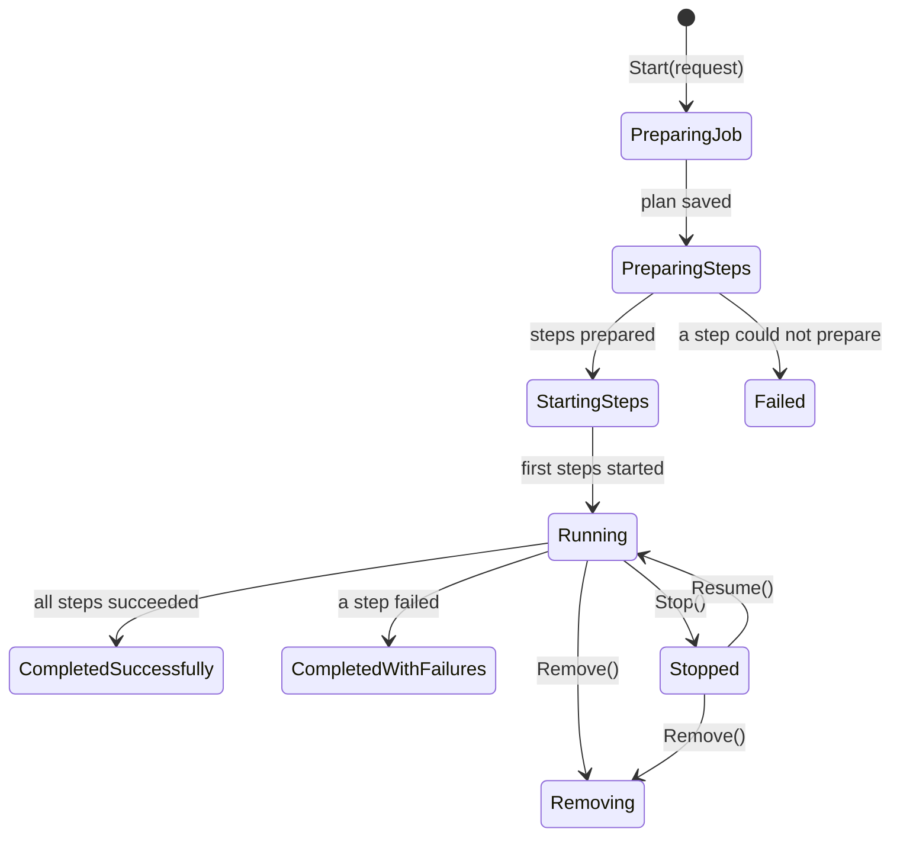

A replay, a migration or a provisioning pass takes longer than a request and longer than the process that
started it. Run it as a background task and a deployment kills it halfway: nobody knows how far it got, which
parts succeeded, or whether running it again will do the work twice. Cratis Choreography **jobs** are the
building block for work like this. A job **plans** what it will do, saves that plan, and then performs it as
**steps**, each step its own Orleans grain. Every status change, count and outcome is persisted, so a
restarted silo picks the job up where it stopped.

## What you write and what the framework does

You write a request record, a job class that says which steps to run, and the step classes that do the work.
The framework does the rest:

| You write | The framework does |
| --- | --- |
| A request implementing `IJobRequest` | Saves it with the job and hands it back after a restart |
| `PrepareSteps` on a `Job<TRequest, TJobState>` | Saves the plan before preparing any step, so recovery never re-plans |
| `JobStep<TRequest, TResult, TState>` classes | Activates each step as its own grain, throttled per silo, and persists its state |
| Optional hooks such as `OnAllStepsCompleted` | Counts outcomes, retries when asked, finalizes the job and calls your hook |

Nothing needs registering: job and step types are discovered by convention, and the host registers the
storage-backed grain providers. See [Run your first job](../getting-started/index.md) for a complete service.

## The lifecycle of a job

A job that completes removes its own record by default and a job in `Removing` clears itself once its steps
have reported. `Failed` means the job could not get going, for example because a step could not be
prepared. A job whose steps ran and some failed ends `CompletedWithFailures` instead.

## Steps are grains

Each step runs as an independent grain activation, so slow or hanging steps cannot stall each other or the
job's own bookkeeping, and steps run in parallel. The step reports back to the job grain; the job counts
outcomes and never performs the work itself. Every silo has one throttle shared by all steps it hosts:
`JobsOptions.MaxParallelSteps` caps how many step bodies run at once and defaults to the number of processor
threads minus one, never less than one. See [Options](../reference/options.md) for every default.

## What a job remembers

A job's status, progress and request persist through the jobs storage, not through events. Choose where that
lives in [Storage](../storage/index.md). Three settings decide how long the record stays:

- A job that completes successfully removes itself. Override `KeepAfterCompleted` to return `true` and the job
  stays queryable.
- A job that completes with failures is **kept** by default, so the failure stays readable. A job that runs on
  a short cadence would otherwise keep one record per failed run for as long as the failure lasts; it
  overrides `KeepAfterCompletedWithFailures` to return `false` and reports its failures some other way.
- Kept terminal jobs, and `Failed` jobs, are removed by cleanup after `JobsOptions.TerminalJobRetention`
  (7 days by default; `Timeout.InfiniteTimeSpan` keeps them indefinitely).

The terminal status is persisted before state is cleared. A failed terminal write is retried while the
activation stays alive, without running the completion hook again. A failed clear is retried once, and any
record that remains is left to the retention cleanup.

## Look at a running job

The jobs manager for a scope and namespace answers questions about jobs. `GetJobs(JobQuery)` returns one
bounded page filtered by type, status and age; `GetAllJobs()` returns every job. Each `JobState` carries its
`Status`, the `StatusChanges` history and a `Progress` with total, successful, failed, stopped and unreachable
step counts, plus per-stage counts for a job with [stages](stages-failures-and-retries.md). Log lines written
by a job carry its id and key as a logging scope.

## When a job is the wrong fit

- **The work finishes inside the request.** A plain `await` is simpler and has nothing to recover.
- **The work is a graph with branches, waits and compensation.** A workflow models that; a job is a flat set
  of steps, optionally ordered in stages. See [Choosing a building block](../choosing-a-building-block.md).
- **You need exactly-once effects.** A step can run twice after a crash. Design each step to tolerate that;
  see [Steps](steps.md).

## Where to go next

- [Planning a job](planning.md): what the saved plan contains and how large plans are stored.
- [Steps](steps.md): step state, activation callbacks and checkpoints.
- [Stages, failures and retries](stages-failures-and-retries.md): ordering, failure behavior and retries.
- [Manage jobs](manage-jobs.md): start, stop, drain and delete a job from your application.
- [Recovery](recovery.md): what happens when a silo goes away.
