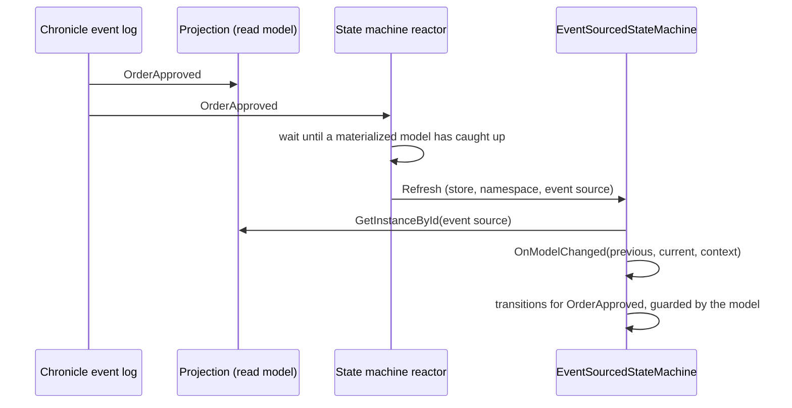

A grain that follows a business process - an order that is placed, approved and shipped, a ticket that is opened,
assigned and resolved - usually ends up keeping its own copy of what the events already say. It persists a status,
subscribes to the events that should change it, and hopes the two never disagree. When a handler fails halfway, or
the grain storage is restored from a different point in time than the event log, they do disagree, and nothing tells
you which one is right.

`EventSourcedStateMachine<TModel>` in the `Cratis.Choreography.Chronicle` package removes the copy. The events in
Cratis Chronicle are the only source of truth. The model is a Chronicle read model projected from them, the grain only
ever reads it, and the state machine's current state is derived from the model every time the grain activates. Events
the state machine is interested in are delivered to it, the model is re-read, and the transitions you declare for the
event decide where it goes next.



## Define a state machine

A state machine names its model, its states and the transitions events drive. The model is an ordinary Chronicle
read model. This one uses model-bound projection attributes, and is passive, which is the recommended choice for a
state machine (see [read model lag](event-sourced-hosting.md)):

```csharp
using Cratis.Chronicle.Events;
using Cratis.Chronicle.Projections.ModelBound;
using Cratis.Chronicle.ReadModels;

[EventType]
public record OrderPlaced(string Customer);

[EventType]
public record OrderApproved;

[EventType]
public record OrderShipped;

public enum OrderStatus
{
    Placed = 0,
    Approved = 1,
    Shipped = 2
}

[Passive]
[FromEvent<OrderPlaced>]
public record Order(
    string Customer,
    [SetValue<OrderApproved>(OrderStatus.Approved)]
    [SetValue<OrderShipped>(OrderStatus.Shipped)]
    OrderStatus Status);
```

The states are the same `State<TStoredState>` types any [state machine](index.md) uses, with the model as the
stored state:

```csharp
using System.Collections.Immutable;
using Cratis.Choreography.StateMachines;

public class Placed : State<Order>
{
    protected override IImmutableList<Type> AllowedTransitions => [typeof(Approved)];
}

public class Approved : State<Order>
{
    protected override IImmutableList<Type> AllowedTransitions => [typeof(Shipped)];
}

public class Shipped : State<Order>;
```

The grain derives `EventSourcedStateMachine<TModel>`. Its grain interface derives `IEventSourcedStateMachine`, a
string-keyed grain interface:

```csharp
using System.Collections.Immutable;
using Cratis.Choreography.Chronicle.StateMachines;
using Cratis.Choreography.StateMachines;

public interface IOrderProcess : IEventSourcedStateMachine
{
    Task<bool> CanBeShipped();
}

public class OrderProcess : EventSourcedStateMachine<Order>, IOrderProcess
{
    protected override Type InitialState => typeof(Placed);

    public override IImmutableList<IState<Order>> CreateStates() => [new Placed(), new Approved(), new Shipped()];

    public async Task<bool> CanBeShipped() => await GetCurrentState() is Approved;

    protected override void DefineTransitions(IStateMachineTransitions<Order> transitions) => transitions
        .On<OrderApproved>().When(order => order.Customer.Length > 0).TransitionTo<Approved>()
        .On<OrderShipped>().TransitionTo<Shipped>();

    protected override Type ResolveState(Order? model) => model?.Status switch
    {
        OrderStatus.Approved => typeof(Approved),
        OrderStatus.Shipped => typeof(Shipped),
        _ => InitialState
    };
}
```

There is no `[StorageProvider]` attribute and no storage to configure. The grain's storage reads the model through
Chronicle and never writes anything. Inside the grain, the protected `Model` property gives the model as the grain
last read it, and `Key` gives its `StateMachineKey`.

## Declare the transitions

`DefineTransitions` declares what each event does:

- `On<TEvent>()` names an event type marked with `[EventType]`, or an interface or abstract type that event types
  implement, which then matches every event type implementing it. Anything else fails startup with
  `TransitionEventIsNotAnEventType`.
- `When(guard)` receives the model as it is after the event. Calling it more than once requires every guard to hold,
  and a guarded transition is never taken while the model has no instance.
- `TransitionTo<TState>()` completes the transition. `TState` must be a state of the same model.

For a delivered event, the transitions declared for its type are evaluated in declaration order. The first whose
guards hold and that the current state allows through `CanTransitionTo` is taken, and the rest are skipped. A
transition that is not taken because of a guard or the current state is skipped without an error.

## Define the projection in code

When the model has no model-bound attributes, describe its projection in `DefineProjection`. It is the same builder an
`IProjectionFor<TModel>` gets:

```csharp
protected override void DefineProjection(IProjectionBuilderFor<Ticket> projection) => projection
    .Passive()
    .From<TicketOpened>()
    .From<TicketAssigned>()
    .From<TicketResolved>(_ => _.Set(ticket => ticket.Resolved).ToValue(true));
```

Overriding it makes the integration register the projection with Chronicle. Leave it alone when the model carries
model-bound attributes, or when Chronicle already discovers a projection for the model; defining a second one fails
startup, as [hosting event-sourced state machines](event-sourced-hosting.md) explains.

## What happens when an event is delivered

1. The reactor finds the grain for the event's event store, namespace and event source.
2. The grain re-reads the model through `IReadModels.GetInstanceById`.
3. `OnModelChanged(previous, current, context)` is called with the model the grain held before the re-read, the model
   after it, and the event's `EventContext`. Either model is `null` while there is no instance.
4. The transitions declared for the event type are evaluated against the refreshed model.

A grain that the delivery itself activates has already read a model that includes the event, so `previous` and `current`
can be the same instance, and `ResolveState` has already put it in the state that model implies. The declared
transition is then usually refused, because the state the grain is already in does not allow its own target, and
nothing happens. Do not rely on `previous` differing from `current`.

Nothing about the current state is persisted. When the grain activates, `ResolveState(model)` - by default
`InitialState` - decides the state it enters, so the state after a restart, a deactivation or a move to another silo
is always what the authoritative model says. Make `ResolveState` agree with your transitions, because it is what the
state machine becomes the next time it activates. `ResolveActivationState()` is sealed here and calls `ResolveState`.

## Grain keys and namespaces

A state machine's grain key is a `StateMachineKey`: `{eventStore}/{namespace}/{eventSourceId}`. The event store and
namespace are part of the key, so the same event source in two namespaces - two tenants - is two grains, and each
reads its model from its own namespace. The event source id may contain `/`; the event store name and namespace may
not, and a key that cannot be formatted or parsed throws `InvalidStateMachineKey`.

Get a state machine from application code with the `IGrainFactory` extensions:

```csharp
using Cratis.Chronicle;
using Cratis.Choreography.Chronicle.StateMachines;

public class OrderShipping(IGrainFactory grainFactory, IEventStore eventStore)
{
    public Task<bool> CanBeShipped(string orderId) =>
        grainFactory.GetEventSourcedStateMachine<IOrderProcess>(eventStore, orderId).CanBeShipped();
}
```

Passing the request's tenant-resolved `IEventStore` picks the namespace it is bound to. There are overloads taking an
explicit `EventStoreName`, event source id and optional namespace (the default namespace when omitted), and one taking
a `StateMachineKey`.

The grain reaches Chronicle through `IStateMachineEventStores`, which asks `IChronicleClient` for the event store of
the namespace in its key. It never uses a scoped, request-resolved `IEventStore`, because a grain has no request.

The next page, [hosting event-sourced state machines](event-sourced-hosting.md), registers them with Chronicle and
covers the options, read model lag and failures.
