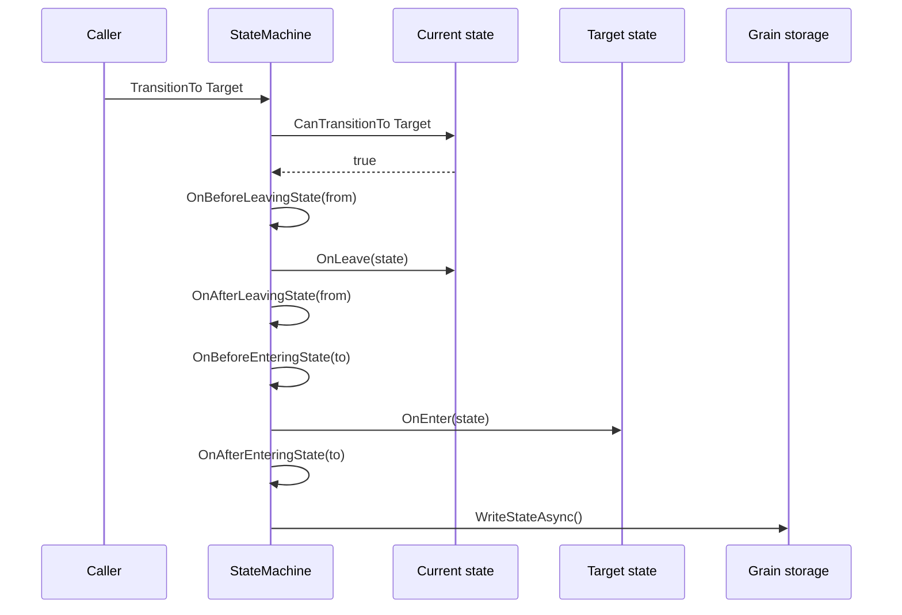

A grain with a lifecycle - a document that is drafted, published and archived, an observer that is catching up,
observing or replaying - tends to grow a status field and a thicket of `if` statements that check it. Every method
has to remember which statuses it is valid in, what to clean up when the status changes, and what to do after a
restart. Miss one check and the grain does work it should not do in the state it is in.

`StateMachine<TStoredState>` in `Cratis.Choreography.StateMachines` replaces that with explicit states. Each state is an
object that says which states it can move to and what happens when the grain enters and leaves it. The state machine
enforces the transitions, runs the enter and leave behavior in order, persists the grain state, and puts the grain
back into the state it was in when it activates again. The framework does that bookkeeping on every transition, so
the grain methods stay one line long.

## The shape of a state machine

A state machine is an Orleans grain with persistent state. You derive `StateMachine<TStoredState>`, create its
states, and name the state it starts in:

```csharp
using System.Collections.Immutable;
using Cratis.Choreography.StateMachines;
using Orleans.Providers;

public class DocumentState : StateMachineState
{
    public string Title { get; set; } = string.Empty;
    public DateTimeOffset PublishedAt { get; set; }
}

public interface IDocument : IGrainWithGuidKey
{
    Task Publish();
    Task Archive();
}

[StorageProvider(ProviderName = "documents")]
public class Document : StateMachine<DocumentState>, IDocument
{
    protected override Type InitialState => typeof(Draft);

    public override IImmutableList<IState<DocumentState>> CreateStates() =>
        ImmutableList.Create<IState<DocumentState>>(new Draft(), new Published(), new Archived());

    public Task Publish() => TransitionTo<Published>();

    public Task Archive() => TransitionTo<Archived>();
}
```

A state derives `State<TStoredState>` and lists the states it allows the grain to move to:

```csharp
using System.Collections.Immutable;
using Cratis.Choreography.StateMachines;

public class Draft : State<DocumentState>
{
    protected override IImmutableList<Type> AllowedTransitions => ImmutableList.Create(typeof(Published), typeof(Archived));
}

public class Published : State<DocumentState>
{
    protected override IImmutableList<Type> AllowedTransitions => ImmutableList.Create(typeof(Archived));

    public override Task<DocumentState> OnEnter(DocumentState state)
    {
        state.PublishedAt = DateTimeOffset.UtcNow;
        return Task.FromResult(state);
    }
}

public class Archived : State<DocumentState>;
```

`Archived` allows no transitions, so once a document is archived, `Publish()` and `Archive()` do nothing. The
grain methods do not check a status; the current state decides.

`InitialState` defaults to `NoOpState<TStoredState>`, a state that allows every transition and does nothing on enter or
leave. A machine that does not override it starts unconstrained, and the `IsInActiveState` property stays `false`
until it enters one of your states.

:::note[State objects are in-process]
`GetCurrentState()`, `GetStates()` and `CanTransitionTo<TState>()` come from `IStateMachine<TStoredState>`, which is
not a grain interface. Call them inside the grain, as `CanBeShipped()` does in
[event-sourced state machines](event-sourced.md), and expose a purpose-built grain method rather than a state object.
:::

## What a transition does

`TransitionTo<TState>()` asks the current state whether it may move to `TState` by calling its
`CanTransitionTo<TState>()`. The default implementation answers from `AllowedTransitions`; override
`CanTransitionTo<TTargetState>` when the answer depends on the stored state. When the answer is no, nothing happens:
the task completes without an error or a transition. Call `CanTransitionTo<TState>()` yourself when you need to
branch on whether the current state allows a target. When the answer is yes and no transition is in progress, the
transition runs in this order:



`OnLeave` and `OnEnter` both receive the stored state and return it, so a state can replace the stored state
instead of mutating it. The value `OnLeave` returns is what `OnEnter` receives. The four `On…State` methods are
virtual on the state machine, for behavior that applies to every state.

| Situation | Behavior |
| --- | --- |
| The target is not one of the states the machine created | `UnknownStateTypeInStateMachine` is thrown |
| The current state does not allow the target | Nothing happens - no leave, no enter, no write |
| A transition is requested while another is entering a state, in its entering hooks, or during persistence | The task completes on admission; the target joins a FIFO queue and is checked again if another state entry occurs before it runs |
| A transition is requested while the machine is leaving a state, in `OnBeforeLeavingState`, `OnLeave` or `OnAfterLeavingState` | `TransitioningDuringOnLeaveIsNotSupported` is thrown |
| A lifecycle hook, persistence, or a guard checked during the drain throws | The exception reaches the caller that owns the drain, all pending targets are discarded, and the machine accepts fresh requests. During activation the owner is `OnActivateAsync`, so the activation fails |
| The machine stays in the same state and the stored state is the same instance | The write is skipped |

The last rule matters when a state re-enters itself: mutating the stored state in place leaves the same instance, so
the change is not written. Return a new instance from `OnEnter` when a self-transition must persist.

## Deferred admission is not completion

If `Holding.OnEnter` awaits I/O and two requests for `A` and then `B` are admitted, the machine finishes entering
`Holding`, then considers `A`, then `B`. Guards run at request time, before admission. If no state has been entered
since the target's request-time guard began, the admission decision stands. Otherwise the target is checked against
the state it would leave and silently skipped if refused. Self-entry and returning to a previously entered state both
count as new entries. If `Holding` allows `A` and `A` allows `B`, both run in order. If `A` refuses `B`, the machine
stays in `A` and silently skips `B`. That preserves request-scoped permission when no state entry has intervened,
without bypassing the transition rules of an intermediate or re-entered state. Because a queued target's guard may run
twice, keep guards free of side effects. If a guard itself awaits, FIFO order follows when requests are admitted, not
necessarily when their calls began. Nested requests append behind already admitted targets.

The caller that starts an idle transition waits for that transition and its queued drain. A request admitted while
that transition is entering completes its task on admission, before its target runs. This lets `OnEnter` await a
nested `TransitionTo` without deadlocking; it also means awaiting an interleaved request does not prove that its
target has been entered. A refusal at request time completes silently without queuing. A queued target refused during
the drain is silently skipped, and the drain continues with the next target.

:::caution[Deferred targets are in-memory intents]
They are not durable or exactly-once work. If enter, leave, an enclosing hook or persistence fails, the drain stops and
discards every pending target. The caller that owns the drain observes the exception; callers whose admission tasks
already completed do not receive a later failure. A fresh request uses the current in-memory state. The machine does
not roll back completed hooks, stored-state assignments or external effects.
:::

There is no merge guarantee for the stored state. If another grain call replaces or changes the stored state while
`OnEnter` awaits, the value `OnEnter` later returns becomes the stored state and can overwrite those changes. The
machine cannot merge arbitrary `TStoredState` values; coordinate such updates in your grain, or return the latest
state from the hook.

## Where to go next

- [Persist, restore and test a state machine](persistence-and-testing.md) covers what is recorded, supplying your own
  storage, deriving the activation state and testing a state on its own.
- [Event-sourced state machines](event-sourced.md) drive the same states from Chronicle events instead of persisting
  anything in the grain.
- [Choosing a building block](../choosing-a-building-block.md) compares state machines with jobs, workflows and workers.
