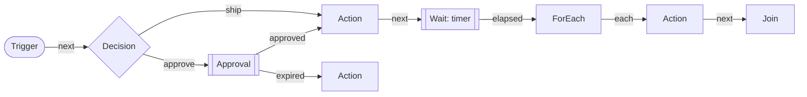

An order is placed. You wait for an approval, call a service, wait a day, fan out over the order lines and gather
the results. Written by hand, that is a chain of grains, timers and flags, and each of them can lose its place when a silo
restarts, a grain deactivates or a message arrives twice. A workflow in Cratis Choreography is that process written
as data, and the engine runs it so that it never loses its place: a run survives a restart, a deactivation and a move
between silos, and each piece of work in it runs as a [job](../jobs/index.md), so it is retried, stoppable and recoverable.



## The model

A workflow is a `WorkflowGraph`: nodes, and edges between the named outlets of those nodes.

| Node kind | What it does |
| --- | --- |
| `Trigger` | The entry point. The run starts here with the trigger's payload and leaves through `next` |
| `Action` | Performs a capability, typically by sending a command, through an `IWorkflowNodePerformer` |
| `Decision` | A capability that picks one of the node's own outlets |
| `Wait` | Waits for a signal or for time to pass, and can run out of time |
| `Approval` | Waits for a person to approve or reject, and can run out of time |
| `ForEach` | Fans out over a list with bounded parallelism, one branch per item, leaving through `each` |
| `Join` | Gathers the branches of one `ForEach` as `All`, `Any` or `AtLeast`, leaving through `completed` or `partial` |

A node declares the outlets it may leave through, and an edge connects one outlet to another node. The engine gives
meaning to twelve names, such as `next`, `failed`, `elapsed` and `approved`; the [reference](reference.md#outlets)
lists them all. A decision invents its own. Each node also carries a `WorkflowNodePolicy`: the attempts a failing node
gets, the time one attempt may take, the delay between attempts and how often a branch may visit the node. That last
limit is what lets a graph loop and still terminate.

A graph is plain data, and a run records the graph it was admitted with. This one fans out over the lines of an order,
ships each, and asks a person what to do when some lines could not be shipped:

```csharp
using Cratis.Choreography.Workflows.Graphs;

var policy = new WorkflowNodePolicy(
    MaxAttempts: 3,
    AttemptTimeout: TimeSpan.FromMinutes(1),
    RetryDelay: TimeSpan.FromSeconds(10),
    MaxVisits: 1);

var graph = new WorkflowGraph(
    [
        new("start", WorkflowNodeKind.Trigger, new("manual", 1), WorkflowNodeConfiguration.Empty, ["next"], WorkflowNodePolicy.Default),
        new("load-lines", WorkflowNodeKind.Action, new("orders.load-lines", 1), WorkflowNodeConfiguration.Empty, ["next"], policy),
        new("per-line", WorkflowNodeKind.ForEach, new("engine.for-each", 1),
            """{"itemsFrom":"load-lines","itemsProperty":"lines","maxParallelism":4}""", ["each"], WorkflowNodePolicy.Default),
        new("ship-line", WorkflowNodeKind.Action, new("orders.ship-line", 1), WorkflowNodeConfiguration.Empty, ["next"], policy),
        new("all-shipped", WorkflowNodeKind.Join, new("engine.join", 1),
            """{"forEach":"per-line","mode":"all"}""", ["completed", "partial"], WorkflowNodePolicy.Default),
        new("review", WorkflowNodeKind.Approval, new("engine.approval", 1),
            """{"expiresAfter":"2.00:00:00"}""", ["approved", "rejected", "expired"], WorkflowNodePolicy.Default)
    ],
    [
        new("start", "next", "load-lines"),
        new("load-lines", "next", "per-line"),
        new("per-line", "each", "ship-line"),
        new("ship-line", "next", "all-shipped"),
        new("all-shipped", "partial", "review")
    ]);
```

The graph never says how an `Action` is done. It names a capability, `orders.load-lines` at version 1, and your
application supplies the code that performs it, as [host and start](host-and-start.md) shows. Only `Action` and
`Decision` nodes are performed: the capability of a `Trigger`, `Wait`, `Approval`, `ForEach` or `Join` node is never
looked up.

## How a run moves

Every node receives the same input: the trigger's payload, subject and correlation, the output of each node that has
already succeeded, and the current `item` when it runs inside a `ForEach` branch. A node sees the latest output of
nodes in its own branch, and otherwise of the root branch.

- **Each arrival is a visit.** There is no implicit merge. A node with two incoming edges runs once per arrival, and the
  second visit fails with `VisitLimitExceeded` while `MaxVisits` is 1. Gather parallel paths with a `ForEach` and its `Join`,
  or raise `MaxVisits` where a loop is intended.
- **A failure has an outlet.** A node that fails for good leaves through `failed` when that outlet is connected. A node
  that answered with an undeclared outlet or unusable output leaves through `fallback` first. A failure in the root
  branch that nothing handles fails the run once the work in flight has ended. In a `ForEach` branch it only ends that branch, and the join
  reports it.
- **Nothing is left dangling.** When nothing is in flight, the run finishes, and every node that no path reached is
  recorded as unreachable.

## Definitions and admission

A definition is a versioned `WorkflowDefinitionSnapshot`: the graph, the owning area, the subject kind the workflow is
about and the capability versions it is pinned to. A run pins the snapshot it was admitted against, so changing a
definition never changes a run in flight. Before a run is admitted, the `IWorkflow` grain checks that:

- a source owns the workflow and returned an active snapshot;
- the snapshot's subject kind equals the trigger's subject kind;
- the payload is valid JSON of at most 32 KiB;
- every `IWorkflowAdmissionPolicy` passes. `StructuralAdmissionPolicy` is always there and refuses a graph with no trigger, an
  unknown node, an undeclared outlet, a `ForEach` without exactly one `Join`, a nested `ForEach`, an unbounded cycle or a
  configuration that does not fit its kind. Add your own by implementing the interface.

An admission that fails answers with its rejections and starts nothing.

## When a workflow is the wrong fit

A workflow is the right shape when a process has several steps, waits for people or time, and branches or fans out. It is
heavier than the problem when:

- one entity moves through a lifecycle on its own. A [state machine](../state-machines/index.md) fits that better.
- the work is a fixed batch of steps that run once, with no waiting or branching. A [job](../jobs/index.md) is enough.
- the work is a single call. Write the call.

[Choosing a building block](../choosing-a-building-block.md) compares them side by side. To see how a run stays
durable, read [the runtime](runtime.md).
